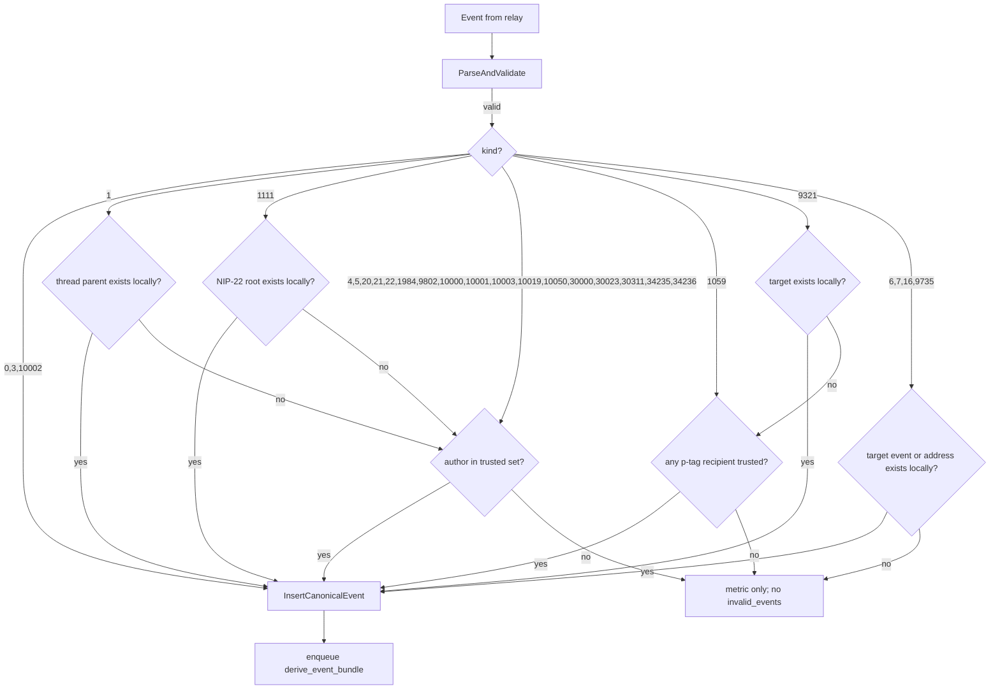

# Trust-bounded canonical ingest

Use this page when you need the full picture for NostrMash's storage-bounding layer: how the ingest gate limits what enters canonical storage, how engagement raw retention caps high-volume exhaust, and how trust prerequisites feed both.

For trust graph computation and score runs, see [trust-subsystem.md](trust-subsystem.md). For operator rollout steps and env var setup, see [../operations.md#trust-bounded-ingest-rollout](../operations.md#trust-bounded-ingest-rollout). For the generated env reference, see [../configuration.md](../configuration.md).

## Problem

On a fixed disk, subscribing to broad relay filters and storing every kind indefinitely refills Postgres in weeks. NostrMash is a local-first indexed system, not an infinite archive. The trust-bounded ingest layer draws the working-set boundary at the web-of-trust subgraph instead of the full firehose.

## Design summary

- Relay subscriptions stay broad (relays cannot filter by author at scale). Enforcement happens locally in the ingest hot path.
- Kinds `0`, `3`, `10002` remain open so the trust graph can grow and profiles resolve. This is acceptable for the first rollout, not a permanent guarantee against kind-0/3 spam.
- Census kinds (git, wiki, publications, calendar, classifieds, voice, relay monitors, the NIP-90 registry, and NIP-29 moderation) are counted into `kind_activity_daily` and are not stored. Graph, thread, zap, content, moderation, cohort, and relay-health counters are written as first-claim daily rows or the once-per-day ecosystem rollup.
- Root kind `1` notes (no thread parent) and authored kinds `4` (DMs, gated on sender trust), `5` (deletion tombstones), `8` (badge awards), `9`/`11` (group messages), `20`/`21`/`22` (pictures and video), `34235`/`34236` (addressable video), `1063` (file metadata), `1068` (polls), `1984` (reports), `1985` (labels), `9041` (zap goals), `9802` (highlights), the replaceable list kinds, `30311` (live activities), `30315` (user status), and `30023` (long-form articles) are hard-gated: persist only when the author is in the trusted set. Kinds `39000`–`39003` are accepted only when the event pubkey equals the source relay's NIP-11 pubkey. Kind `1059` gift wraps are gated on a trusted `p`-tag recipient, because the author key is ephemeral. Kind `9321` nutzaps follow the kind `9735` target-exists rule and fall back to a trusted recipient. Kinds `1018` and `1311` follow the target-exists rule (poll event, live-activity address).
- Kind `1` replies whose thread parent (NIP-10 `reply`, else `root` / legacy single `#e`) already exists locally are accepted from any author — the same target-exists rule as engagement — so conversation totals are not capped to the trust graph. Mentions alone do not open this bypass. Kind `1111` comments follow the same split on the NIP-22 root (uppercase `E` event id or uppercase `A` address).
- Kinds `6`, `7`, `16`, and `9735` are kept only when their target already exists locally (engagement on already-stored/trusted content). Kind `16` accepts an `e` event id or an `a` address resolved through `replaceable_state`. Engagement that arrives before its target is dropped permanently in v1 (no pending buffer).
- Kind `5` used to also accept deletions whose referenced `e`-tag target existed locally; that path still let untrusted tombstone spam dominate the events table, so deletions are now strictly author-gated like notes.
- Raw engagement events are purged after a short retention window. Lifetime aggregate counters (`reaction_counts`, `repost_counts`) survive because they have no FK to `events`.

## Components

### Trust prerequisites (`trust_worker`)

The gate reads `trust_graph_snapshot`, not live follower edges on every event.

| Component | Env / location | Role |
| --- | --- | --- |
| Seed reconcile | `TRUST_SEED_PUBKEYS` → `trust_seeds` | On startup, `trust_worker` upserts configured seeds and deactivates seeds no longer in the list. Skipped when `TRUST_SEED_PUBKEYS` is empty (manual SQL seeding still works). |
| Snapshot refresh | `TRUST_GRAPH_SNAPSHOT_REFRESH_INTERVAL` (default `30m`) | Rebuilds `trust_graph_snapshot` from active seeds + `follower_edges` BFS up to `TRUST_MAX_HOPS`. Runs once immediately on startup. |
| Global trust runs | `TRUST_RUN_INTERVAL` (default `1h`) | Schedules PageRank-style global score runs when score compute is enabled and no run is active. |

On a fresh database the snapshot is seeds-only until kind-3 contact lists arrive.

### In-memory trusted set (`ingestor`)

| Component | Env | Role |
| --- | --- | --- |
| `TrustedAuthorSet` | `INGESTOR_TRUST_GATE_REFRESH_INTERVAL` (default `2m`) | Loads pubkeys from `trust_graph_snapshot WHERE min_hops <= INGESTOR_TRUST_GATE_MAX_HOPS` (default `2`). Avoids a per-event DB lookup. |
| Last-good retention | — | Failed refreshes keep the previous set; staleness is visible via `nostrmash_ingest_trusted_set_age_seconds`. |
| Fail-closed | `INGESTOR_TRUST_GATE_MODE=trusted_only` | If the set has **never** loaded successfully, author-gated kinds (`1` roots / `4` / `5` / `20` / `21` / `22` / `1984` / `9802` / `10000` / `10001` / `10003` / `10019` / `10050` / `30000` / `30023` / `30311` / `34235` / `34236`) and recipient-gated kinds (`1059`, and `9321` when no target is stored) are rejected. Open kinds, target-local engagement, kind-1 replies to already-stored parents, and kind-1111 comments on a stored root are unaffected so the graph can bootstrap. |

### Ingest gate (`ingestor`)

| Env | Default | Meaning |
| --- | --- | --- |
| `INGESTOR_TRUST_GATE_MODE` | `open` | `open`: shadow mode — record gate metrics, never reject. `trusted_only`: enforce. |
| `INGESTOR_TRUST_GATE_MAX_HOPS` | `2` | Hop distance from a seed for author trust (separate from `TRUST_MAX_HOPS` used elsewhere). |
| `INGESTOR_TRUST_GATE_REFRESH_INTERVAL` | `2m` | How often the in-memory trusted set reloads from Postgres. |

Gate decisions per kind:

- `0`, `3`, `10002`: always accept.
- `1`: accept if the thread parent already exists locally (any author), else accept iff author in trusted set (or shadow-reject in `open` mode). Parent resolution matches thread projection: prefer `e` marked `reply`, else `root` / legacy single unmarked `#e`. Mentions do not count as a parent.
- `4`, `5`, `20`, `21`, `22`, `1984`, `9802`, `10000`, `10001`, `10003`, `10019`, `10050`, `30000`, `30023`, `30311`, `34235`, `34236`: accept iff author in trusted set (or shadow-reject in `open` mode). Kind `4` is gated on the sender (author) being trusted. Kind `5` deletions are author-gated only (no target-exists bypass).
- `1059`: accept iff any `p`-tag recipient is trusted. The author key is ephemeral.
- `9321`: accept when the first `e` tag or an `a` address is already stored; otherwise the same trusted-recipient rule as `1059`.
- `1111`: accept when the NIP-22 root exists locally (uppercase `E`, or uppercase `A` resolved to the current replaceable), else the author gate.
- `6`, `7`, `16`, `9735`: accept iff a target exists locally. Kind `9735` uses the same first-`e`-tag rule as zap derivation. Kind `16` also accepts an `a` tag resolved through `replaceable_state`.

Rejected events increment metrics only. They are **not** written to `invalid_events` (they are valid Nostr events, just out of scope). The live resume checkpoint still advances so restarts do not re-fetch and re-drop the same span.

### Bridged content (`ingestor` + `worker`)

Events carrying a NIP-48 `proxy` tag are copies of content from another network (ActivityPub via mostr/momostr, RSS, Bluesky bridges). nostrmash indexes native Nostr, so they are dropped before any write, regardless of kind or gate mode. The check runs before the trust gate and the observation sink, so a bridged author never enters the observed-pubkey funnel either. The drop is recorded as gate decision `reject_bridged` and ingest outcome `bridged`; the live checkpoint advances as for other rejections. Every ingest path (live, backfill, trust fetch, contact crawl) shares `processor.Handle`, so there is no side door.

| Env | Default | Meaning |
| --- | --- | --- |
| `INGESTOR_DROP_BRIDGED` | `true` | Drop NIP-48 proxied events at ingest. |
| `WORKER_RETENTION_BRIDGED_ENABLED` | `true` | Purge bridged events stored before the ingest drop existed. Candidates come from the partial index `idx_event_attributes_bridged`, so once the backlog is gone each tick is a single index probe. |
| `WORKER_RETENTION_BRIDGED_RUN_INTERVAL` | `10m` | Idle probe cadence after the backlog drains. |
| `WORKER_RETENTION_BRIDGED_BATCH_PAUSE` | `2s` | Pause between consecutive full batches while draining. |
| `WORKER_RETENTION_BRIDGED_DELETE_BATCH_LIMIT` | `2000` | Max events deleted per batch. |

The purge reverses projections and deletes the raw rows through the same path as the other retention targets, and additionally removes `profile_discovery_stats`, `profile_public_stats`, `profile_fields`, and `nip05_verifications` rows for authors in the batch that have no events left, so a bridged account disappears from profile rankings in the same transaction as its last event. `profiles_latest` cascades from the kind-0 delete, and the worker drops those authors' Meilisearch profile documents (profile search hits are served from the index without a Postgres hydration step; note hits are hydrated, so purged notes vanish on their own). Aggregates that already counted bridged events (`content_flags_daily`, `bridged_share_bps` in ecosystem stats) keep their history; new days count zero.

### Untrusted-author retention and replies

`WORKER_RETENTION_UNTRUSTED_AUTHOR_*` still purges untrusted root notes and other author-gated kinds after the horizon. Kind-1 events that already have a `thread_edges` row (replies accepted via target-exists) are excluded so conversation totals are not rolled back after ingest.

### Engagement raw retention (`worker`)

| Env | Default | Meaning |
| --- | --- | --- |
| `WORKER_RETENTION_ENGAGEMENT_ENABLED` | `true` | Enable the engagement purge loop. |
| `WORKER_RETENTION_ENGAGEMENT_MAX_AGE` | `768h` (32d) | Purge raw kinds `6`/`7`/`1059`/`9321`/`9735` older than this (by `events.created_at`). One day past the 30d discovery window. Daily zap, client, and DM counters are kept. |
| `WORKER_RETENTION_ENGAGEMENT_DEAD_GRACE` | `168h` (7d) | Derivation-safety: block purge while `derive_event_bundle` is pending/running, or dead with `updated_at` within this window. |
| `WORKER_RETENTION_ENGAGEMENT_RUN_INTERVAL` | `1h` | Scheduled purge cadence. |
| `WORKER_RETENTION_ENGAGEMENT_DELETE_BATCH_LIMIT` | `2000` | Max rows deleted per batch (auto-paced like job retention). |

Cascade FKs clean contribution/interaction rows. `reaction_counts` / `repost_counts` have no FK and survive.

### Superseded replaceable retention (`worker`)

| Env | Default | Meaning |
| --- | --- | --- |
| `WORKER_RETENTION_REPLACEABLE_ENABLED` | `true` | Enable the superseded-replaceable purge loop. |
| `WORKER_RETENTION_REPLACEABLE_MIN_AGE` | `24h` | A superseded version is only eligible once its `events.first_seen_at` is older than this (protects freshly-ingested/backfilled versions). |
| `WORKER_RETENTION_REPLACEABLE_DEAD_GRACE` | `168h` (7d) | Derivation-safety: block purge while `derive_event_bundle` is pending/running, or dead with `updated_at` within this window. |
| `WORKER_RETENTION_REPLACEABLE_RUN_INTERVAL` | `1h` | Scheduled purge cadence. |
| `WORKER_RETENTION_REPLACEABLE_DELETE_BATCH_LIMIT` | `2000` | Max rows deleted per batch (auto-paced like job retention). |

Purges raw replaceable events that have been strictly superseded by a newer winner recorded in `replaceable_state` (latest-wins Nostr semantics). This covers the non-parameterized kinds `0`/`3`/`10000`/`10001`/`10002`/`10003`/`10019`/`10050` (addressed by `pubkey`+`kind`, `d_tag` always empty) and the parameterized kinds `30000`, `30023`, `30311`, `34235`, and `34236` (addressed by `pubkey`+`kind`+`d_tag`, so each distinct `d_tag` is its own latest-wins slot). The purge derives each candidate's `d_tag` with the same first-`d`-tag rule as the replaceable derivation and joins `replaceable_state` on `(pubkey, kind, d_tag)`. The current winner is never deleted, and a newer-but-not-yet-projected version is protected because it ranks above the recorded winner. Cascade FKs clean `event_tags`, `event_relays`, `event_references`, `pubkey_references`, and `follower_edges`; the latest-version projections (`contact_lists_latest`, `relay_lists_latest`, `profiles_latest`, `replaceable_state`) reference the winner and survive. Kind `3` carries the bulk of the savings because superseded contact lists hold the largest tag fan-out, with `30023` article revisions next.

### Processed deletion retention (`worker`)

| Env | Default | Meaning |
| --- | --- | --- |
| `WORKER_RETENTION_DELETION_ENABLED` | `true` | Enable the processed-deletion purge loop. |
| `WORKER_RETENTION_DELETION_MAX_AGE` | `336h` (14d) | Purge raw kind `5` older than this (by `events.created_at`). |
| `WORKER_RETENTION_DELETION_DEAD_GRACE` | `168h` (7d) | Derivation-safety: block purge while `derive_event_bundle` is pending/running, or dead with `updated_at` within this window. |
| `WORKER_RETENTION_DELETION_RUN_INTERVAL` | `1h` | Scheduled purge cadence. |
| `WORKER_RETENTION_DELETION_DELETE_BATCH_LIMIT` | `2000` | Max rows deleted per batch (auto-paced like job retention). |

Migration `000050` dropped the `deletion_events.event_id` FK cascade, turning `deletion_events` into a durable tombstone ledger. The purge removes raw kind-5 events (and their cascade-cleaned tags/references) once derivation has completed; the `(deleter_pubkey, target_event_id, created_at)` ledger row survives so DM/parity deletion knowledge is preserved.

## Config ownership

| Prefix | Owner | Purpose |
| --- | --- | --- |
| `TRUST_*` | `trust_worker` (+ shared policy) | Seeds, snapshot refresh, global trust runs, graph policy for read surfaces |
| `INGESTOR_TRUST_GATE_*` | `ingestor` | Live ingest enforcement |
| `WORKER_RETENTION_ENGAGEMENT_*` | `worker` | Raw engagement purge |
| `WORKER_RETENTION_REPLACEABLE_*` | `worker` | Superseded replaceable purge (kinds 0/3/10000/10001/10002/10003/10019/10050 and parameterized 30000/30023/30311/34235/34236) |
| `WORKER_RETENTION_DELETION_*` | `worker` | Processed deletion purge (kind 5; tombstone ledger kept) |

`TRUST_CANONICAL_INGEST_MODE` is **deprecated**. It was a config placeholder that was never wired into the ingest hot path. Use `INGESTOR_TRUST_GATE_MODE` instead.

## Observability

Gate metrics (ingestor, bounded labels):

- `nostrmash_ingest_gate_decisions_total{kind,decision}` — `kind` is one of `1`, `4`, `5`, `6`, `7`, `16`, `20`, `21`, `22`, `1059`, `1111`, `1984`, `9321`, `9735`, `9802`, `10000`, `10001`, `10003`, `10019`, `10050`, `30000`, `30023`, `30311`, `34235`, `34236`, `open_kind`, `other`; `decision` is one of `accept`, `reject_untrusted_author`, `reject_missing_target`, `shadow_reject`, `fail_closed`
- `nostrmash_ingest_trusted_set_size`
- `nostrmash_ingest_trusted_set_loaded` (0/1)
- `nostrmash_ingest_trusted_set_age_seconds`

Retention metrics (worker, reuses existing retention vectors):

- `nostrmash_retention_purge_runs_total{target="engagement_events",result}`
- `nostrmash_retention_purged_rows_total{target="engagement_events"}`
- `nostrmash_retention_purge_runs_total{target="replaceable_events",result}`
- `nostrmash_retention_purged_rows_total{target="replaceable_events"}`
- `nostrmash_retention_purge_runs_total{target="deletion_events",result}`
- `nostrmash_retention_purged_rows_total{target="deletion_events"}`

Also watch `nostrmash_ingest_events_total{outcome="gated"}` for cumulative gated events.

## Explicit non-goals (follow-ups)

- Note time-window retention for kind `1` (deferred). The same deferral applies to other non-replaceable authored kinds (`4` DMs, `9802` highlights): they are bounded by author-trust gating but not time-windowed.
- The unified `documents` Meilisearch index (and its trigger-maintained `search_documents` table) still covers kind-`1` notes and kind-`0` profiles only. The `notes` index also covers kinds `20`, `21`, `22`, `30023`, `30311`, `34235`, and `34236`, folding `title` and `summary` tags into the indexed text. Those kinds are not yet represented as unified `search_documents` rows.
- Optional pending buffer for engagement whose target has not arrived yet.
- Admin seed HTTP endpoints (`/admin/v1/trust/seeds`).
